<div align="center">

# SentinelAI

### Enterprise AI Governance · Risk Intelligence · Evidence & Audit Platform

**Govern every AI system. Understand every risk. Make every decision accountable.**

An enterprise-oriented governance control plane for registering AI assets, assessing risk, managing evidence, responding to incidents, and maintaining an organization-scoped audit trail.

[Architecture](docs/ARCHITECTURE.md) · [API Guide](apps/api/README.md) · [Security](docs/SECURITY.md) · [Roadmap](docs/ROADMAP.md)

[](https://github.com/matiur25580/SentinelAI-Enterprise-AI-Governance-Risk-Intelligence-Platform/actions/workflows/quality.yml)
[](https://github.com/matiur25580/SentinelAI-Enterprise-AI-Governance-Risk-Intelligence-Platform/actions/workflows/security.yml)


</div>

---

## Table of contents

- [Project at a glance](#project-at-a-glance)
- [What SentinelAI does](#what-sentinelai-does)
- [Dashboard gallery](#dashboard-gallery)
- [Architecture](#architecture)
- [Technology stack](#technology-stack)
- [Repository structure](#repository-structure)
- [Run locally](#run-locally)
- [Environment configuration](#environment-configuration)
- [API surface](#api-surface)
- [Security and governance controls](#security-and-governance-controls)
- [Quality checks](#quality-checks)
- [Deployment and operational readiness](#deployment-and-operational-readiness)
- [Documentation](#documentation)
- [Roadmap](#roadmap)
- [Project boundaries and disclaimer](#project-boundaries-and-disclaimer)

## Project at a glance

| Area | Description |
|---|---|
| Product category | AI governance, risk intelligence, evidence management and auditability |
| Primary users | AI governance teams, security analysts, compliance officers, auditors and workspace administrators |
| Application model | Multi-tenant, organization-scoped governance workspace |
| Web application | Next.js 15 + TypeScript |
| API | NestJS + TypeScript |
| Data layer | PostgreSQL 16+ + Prisma ORM 7 |
| Evidence | Private S3-compatible object storage, SHA-256 verification and ClamAV scanning |
| AI engine | FastAPI starter service; currently health metadata only |
| Delivery | GitHub Actions quality/security workflows and provider-neutral container builds |

> **Project maturity:** SentinelAI is an actively developed engineering project. Core governance workflows and CI checks are implemented, but the platform is not yet a fully production-operated SaaS product. No live customer environment, production database, storage bucket, hosting provider, or alert destination is implied by this repository.

## What SentinelAI does

### 1. AI asset inventory
- Register AI models, LLM applications and AI agents inside an organization workspace.
- Track asset type, provider, model identifier, version, status and descriptive metadata.
- Scope asset reads and writes to the authenticated organization.
- Preserve assessment history by preventing unsafe hard deletion of assets with linked assessments.

### 2. Evidence-backed AI risk assessments
- Create assessments against registered AI assets.
- Capture intended use, scope, data sensitivity, autonomy, impact, likelihood, exposure, mitigation coverage and evidence references.
- Calculate inherent and residual scores on the server using a versioned, transparent heuristic.
- Support draft submission and independent approval/rejection with reviewer rationale.
- Prevent an assessment creator from approving or rejecting their own submission.

### 3. Private evidence lifecycle
- Use short-lived presigned URLs for private S3-compatible uploads and downloads.
- Verify object metadata and SHA-256 checksums; validate supported file signatures and text encoding.
- Scan uploaded evidence with ClamAV before making clean files available to reviewers.
- Quarantine malware detections; support authorized rescan, release and audited purge.
- Record independent evidence verification/rejection, retention metadata and legal holds.
- Retain audit metadata when evidence bytes are purged.

### 4. AI incident management
- Register incidents with severity, source, description, assignment and timestamps.
- Enforce controlled lifecycle transitions: `OPEN → TRIAGED → INVESTIGATING → RESOLVED → CLOSED`.
- Require a resolution summary and preserve lifecycle/assignment changes in the audit history.
- Keep incident records organization-scoped and role-protected.

### 5. Tamper-evident audit trail
- Record security-sensitive governance and administrative actions with actor, entity, timestamp and metadata.
- Provide organization-scoped filtering, pagination, metadata inspection and CSV export.
- Verify the audit hash chain and sequence.
- Enforce append-only behavior at the database layer; UPDATE/DELETE mutations are rejected.

### 6. Session security
- Hash refresh tokens at rest and rotate them on use.
- Bind access tokens to session families.
- Detect refresh-token reuse and revoke the affected family.
- List active sessions and revoke a selected session with an audit event.
- Reject protected requests immediately after session revocation.

### 7. Executive governance reporting
- Aggregate asset inventory, assessment lifecycle and residual risk, incident status/severity, evidence status/legal holds, and audit activity.
- Filter aggregates by inclusive record-creation date range.
- Export spreadsheet-safe CSV summaries.
- Restrict reports to authorized governance roles and the caller's active organization.

### 8. Observability and operational tooling
- Expose a bearer-protected Prometheus metrics endpoint.
- Include request IDs and structured request-completion logging.
- Maintain Prometheus/Alertmanager configuration examples, a Grafana dashboard definition, container SBOM/image scanning, and deployment smoke-check tooling.
- Treat monitoring configuration as deployable assets, not as a claim that a production monitoring stack is already running.

## Dashboard gallery

The following 12 visuals are **designed concept previews** to communicate the product's information architecture and intended governance experience. They are not browser screenshots of a deployed application and contain illustrative sample values only. The actual web workspace and implemented capabilities are described above and in the linked feature documentation.

### 01 · Executive Governance Overview
A leadership-level summary connecting AI inventory, risk posture, incident response, evidence status and accountability activity.

<p align="center">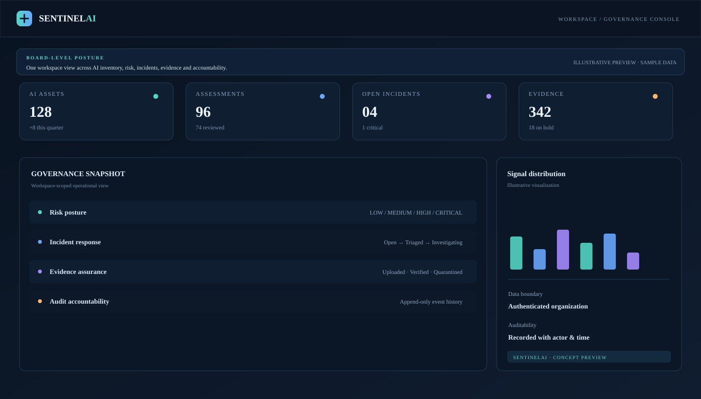</p>

### 02 · AI Asset Inventory
A centralized register for AI models, LLM applications and agents, including lifecycle and review context.

<p align="center">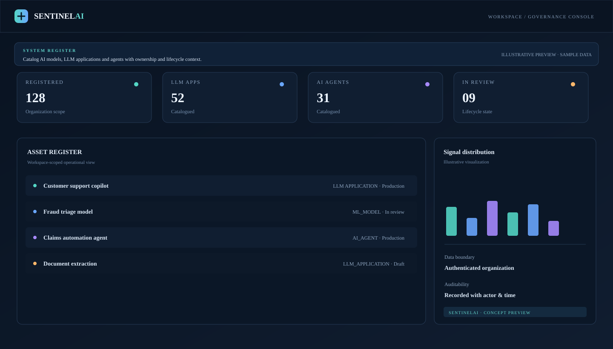</p>

### 03 · Risk Assessment Portfolio
A portfolio-level view of assessment volume, residual risk bands, review status and elevated items.

<p align="center">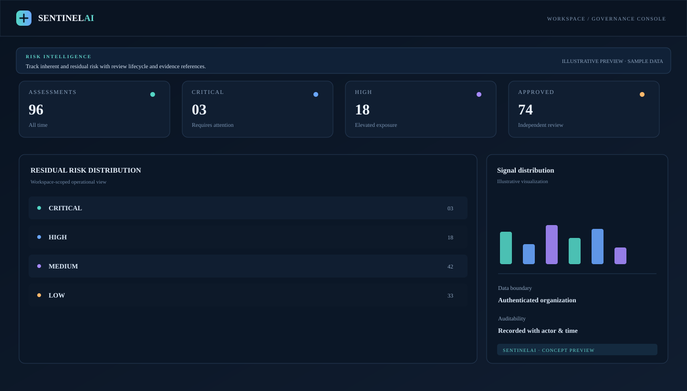</p>

### 04 · Risk Scoring & Independent Review
A closer view of scoring dimensions, mitigation coverage, versioned calculations and separation of reviewer duties.

<p align="center">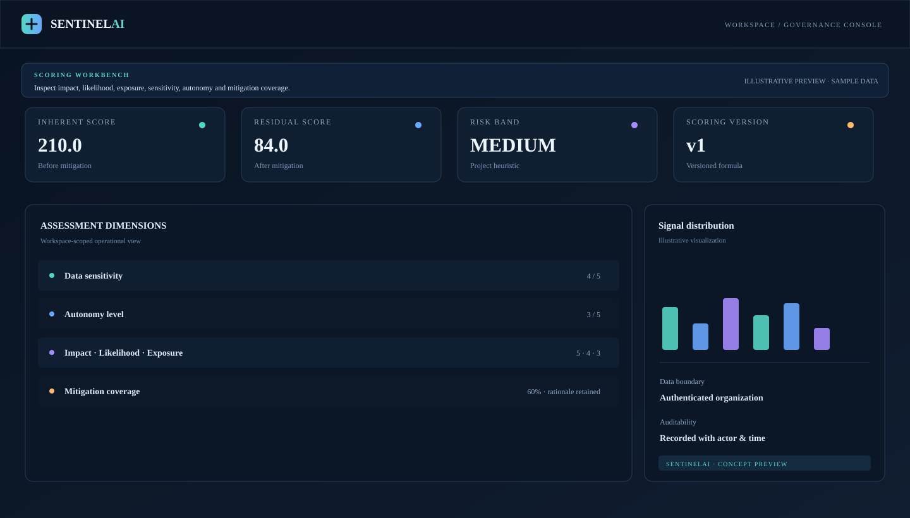</p>

### 05 · Evidence Vault & Verification
A private evidence register showing upload status, checksum metadata and independent reviewer decisions.

<p align="center">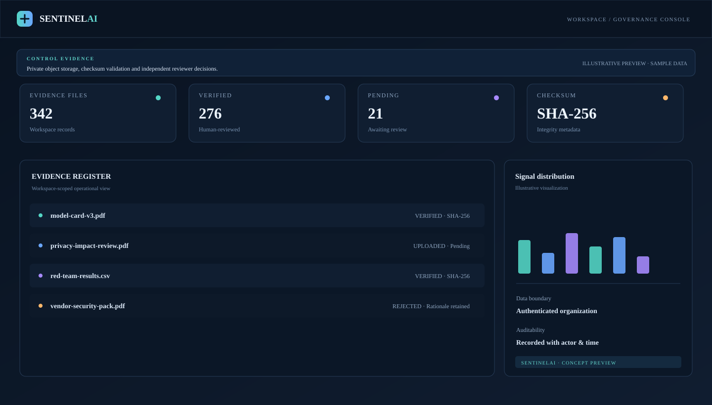</p>

### 06 · Quarantine, Retention & Legal Holds
A controlled evidence lifecycle view for malware quarantine, rescan, retention eligibility, legal holds and audited purge.

<p align="center">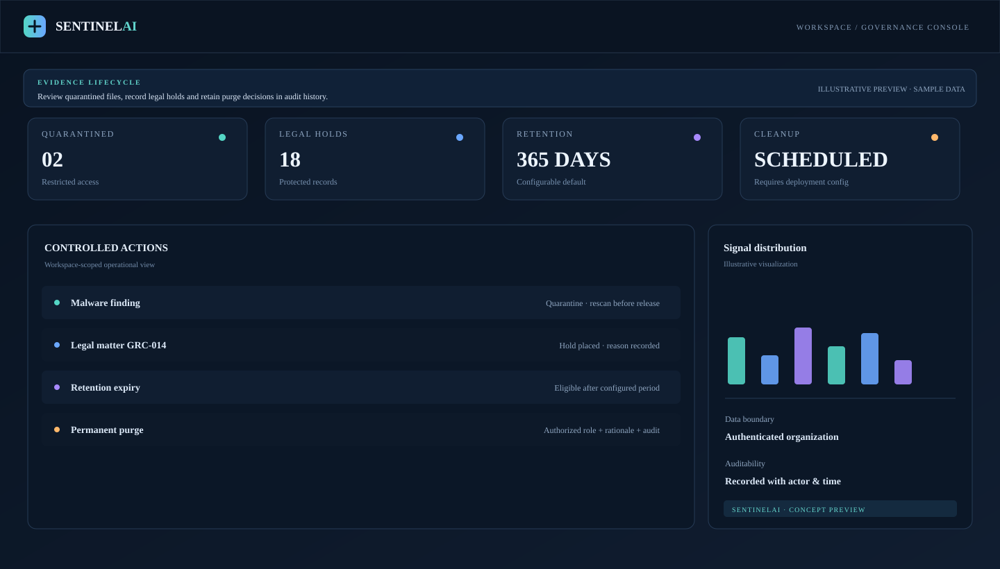</p>

### 07 · AI Incident Response
An incident command view for severity prioritization, assignment, investigation and documented resolution.

<p align="center">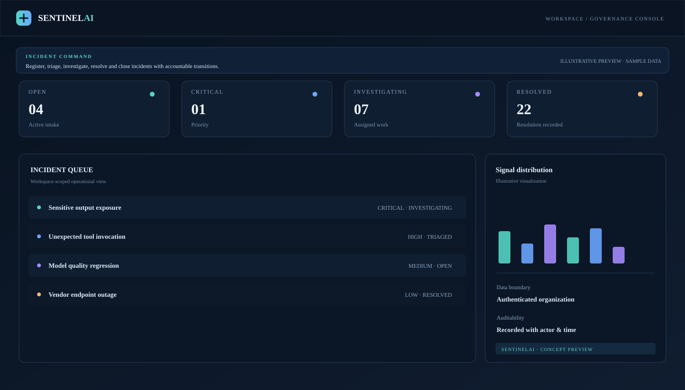</p>

### 08 · Audit Trail Explorer
An accountability timeline with action/entity/date filtering, actor attribution, metadata inspection and export.

<p align="center">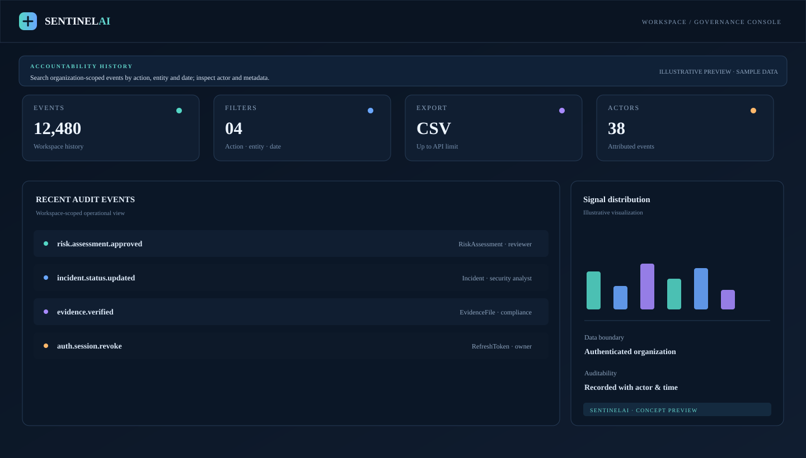</p>

### 09 · Audit Chain Integrity Verification
A tamper-evidence view explaining sequence continuity, previous/current hashes and append-only database protection.

<p align="center">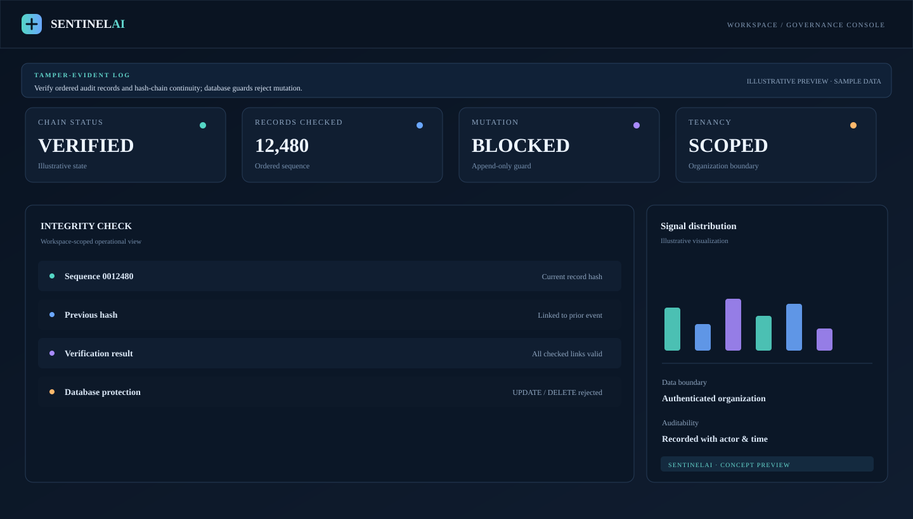</p>

### 10 · Session Security Console
A user-session view for active refresh-token families, session revocation and security audit events.

<p align="center">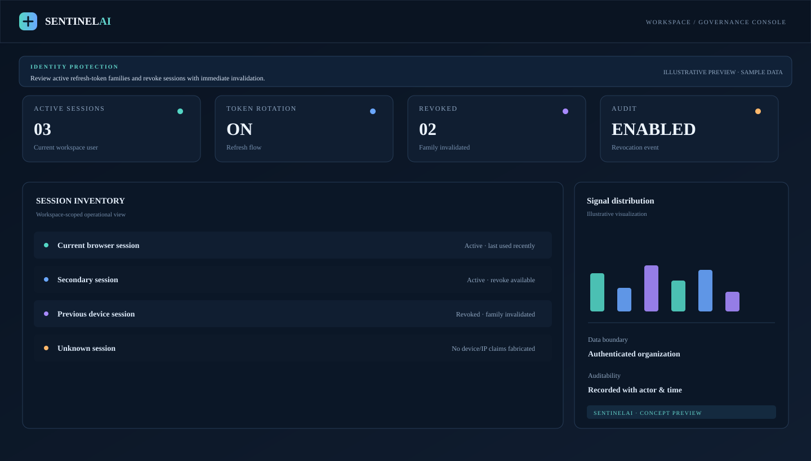</p>

### 11 · Executive Compliance Reporting
A reporting workspace for period filters, governance KPIs, recent audit activity and CSV export.

<p align="center">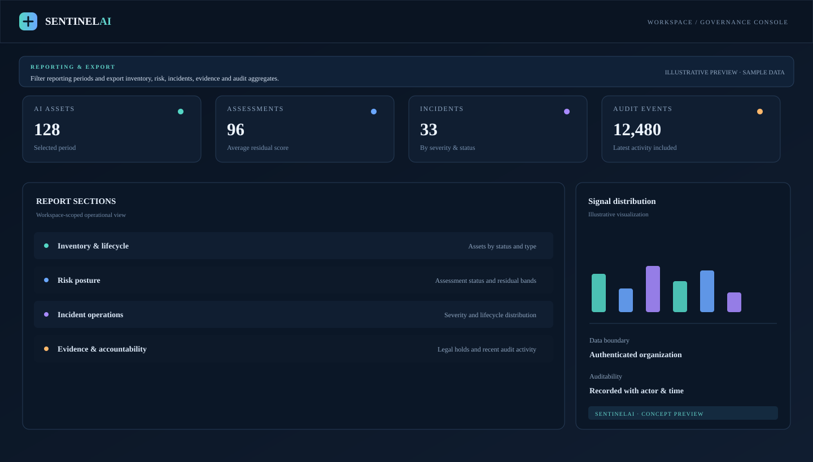</p>

### 12 · Platform Observability & Operations
An operational overview of the repository's metrics endpoint, Grafana assets, alert configuration, container scanning and smoke-check tooling.

<p align="center">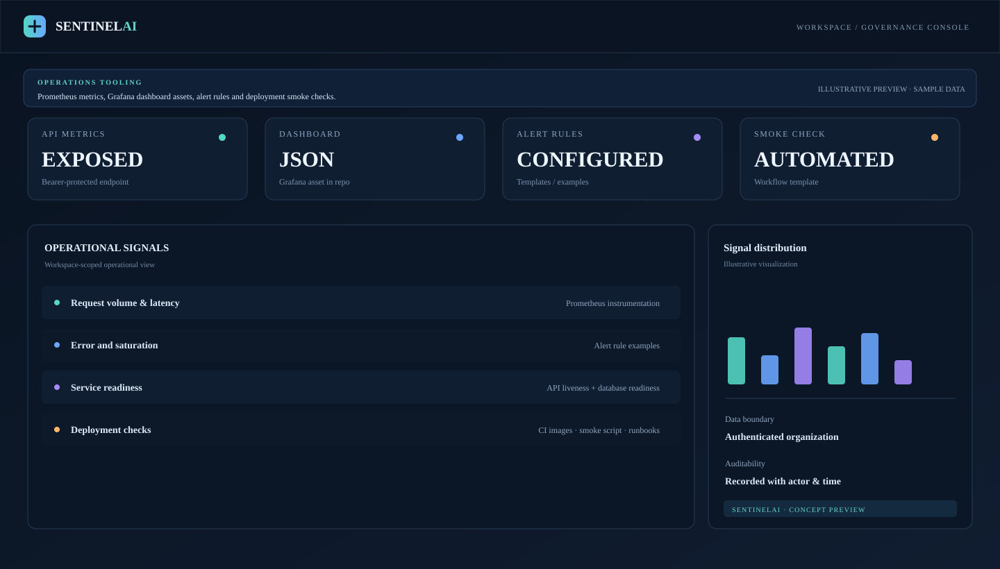</p>

## Architecture

SentinelAI currently follows a modular-monolith API design with a separately scaffolded AI-engine service.

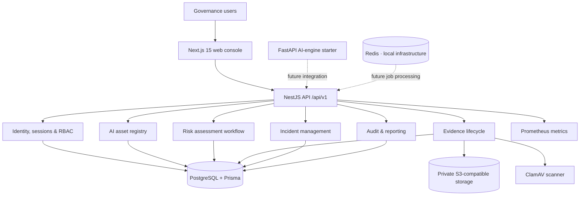

### Architectural principles
- **Tenant isolation:** resolve organization context from the authenticated active membership; do not trust client-supplied organization IDs.
- **Server-side authorization:** enforce role checks in the API, not only in the web interface.
- **Auditability:** write consequential actions alongside their state changes and preserve append-only audit history.
- **Private-by-default evidence:** keep evidence objects private and issue short-lived URLs only after authorization.
- **Explicit lifecycle transitions:** validate state changes and require rationale where the workflow calls for it.
- **Honest AI boundaries:** do not treat the AI-engine starter as an active inference, evaluation or autonomous-agent runtime.

## Technology stack

| Layer | Technology | Responsibility |
|---|---|---|
| Frontend | Next.js 15, React, TypeScript | Authenticated governance workspace |
| Backend | NestJS, TypeScript | APIs, RBAC, workflows and validation |
| Database | PostgreSQL 16+ | Tenant data, sessions, evidence metadata and audit records |
| ORM | Prisma ORM 7 | Schema, client generation and migrations |
| AI service starter | Python, FastAPI | Future AI service boundary; currently health metadata only |
| Evidence storage | S3-compatible object storage | Private object storage through presigned requests |
| Malware scanning | ClamAV | Scan evidence before reviewer access |
| Metrics | Prometheus instrumentation | API request metrics |
| Dashboards | Grafana JSON/provisioning assets | Importable dashboard configuration |
| CI/security | GitHub Actions, CodeQL, dependency audit, Trivy, CycloneDX | Build, security checks, image scanning and SBOM generation |
| Local infrastructure | Docker Compose, PostgreSQL, Redis | Development dependencies |

## Repository structure

```text
.
├── apps/
│   ├── web/                    # Next.js governance console
│   ├── api/                    # NestJS API, Prisma schema and migrations
│   └── ai-engine/              # FastAPI starter service
├── docs/
│   ├── assets/
│   │   └── dashboard-previews/ # 12 labelled concept-preview illustrations
│   ├── ARCHITECTURE.md
│   ├── SECURITY.md
│   ├── RISK_ASSESSMENT_WORKFLOW.md
│   ├── EVIDENCE_STORAGE_WORKFLOW.md
│   └── PRODUCTION_DEPLOYMENT.md
├── ops/
│   ├── grafana/                # Grafana dashboard JSON
│   ├── prometheus/             # Prometheus & Alertmanager examples
│   └── local-monitoring/       # Optional local monitoring stack
├── scripts/                    # Smoke checks and monitoring validation
├── Dockerfile.api
├── Dockerfile.web
├── docker-compose.yml
├── pnpm-workspace.yaml
└── README.md
```

## Run locally

### Prerequisites

- Node.js **22 or newer**
- pnpm **9.15.4**
- Docker Engine/Desktop with Docker Compose
- Python **3.12+** only when running the AI-engine starter separately

### 1. Clone and configure

```bash
git clone https://github.com/matiur25580/SentinelAI-Enterprise-AI-Governance-Risk-Intelligence-Platform.git
cd SentinelAI-Enterprise-AI-Governance-Risk-Intelligence-Platform
cp .env.example .env
```

Open `.env` and replace the development PostgreSQL password and both JWT secrets. Use independent random secrets of at least 32 characters. Never commit the resulting `.env` file.

### 2. Install dependencies and start local infrastructure

```bash
pnpm install
pnpm infra:up
```

### 3. Generate Prisma Client and apply migrations

```bash
pnpm db:generate
pnpm db:migrate
```

### 4. Start the web application and API

```bash
pnpm dev
```

| Service | Local address |
|---|---|
| Web console | http://localhost:3000 |
| API liveness | http://localhost:4000/api/v1/health |
| API readiness (includes PostgreSQL) | http://localhost:4000/api/v1/health/ready |

The AI-engine starter is separate. From `apps/ai-engine`, install its `requirements.txt` and run it with Uvicorn on port 8000. It currently exposes health metadata only; it is not an authenticated inference service.

To stop local PostgreSQL and Redis:

```bash
pnpm infra:down
```

## Environment configuration

The exact required values are defined in [`.env.example`](.env.example) and validated by the API at startup.

| Variable | Purpose |
|---|---|
| `DATABASE_URL` | PostgreSQL connection URL |
| `JWT_ACCESS_SECRET` | Independent access-token signing secret (32+ characters) |
| `JWT_REFRESH_SECRET` | Independent refresh-token signing secret (32+ characters) |
| `API_PORT` | API listening port; defaults to 4000 |
| `WEB_ORIGIN` | Allowed web origin(s); explicitly required in production |
| `TRUST_PROXY_HOPS` | Exact trusted proxy hop count, only when deployed behind a known proxy |
| `METRICS_BEARER_TOKEN` | Optional secret protecting the Prometheus metrics endpoint |
| `EVIDENCE_S3_ENDPOINT` | S3-compatible storage endpoint |
| `EVIDENCE_S3_BUCKET` | Private evidence bucket |
| `EVIDENCE_S3_REGION` | Storage signing region |
| `EVIDENCE_S3_ACCESS_KEY_ID` / `EVIDENCE_S3_SECRET_ACCESS_KEY` | Storage service credentials |
| `EVIDENCE_S3_SESSION_TOKEN` | Optional temporary storage credential |
| `CLAMAV_HOST` / `CLAMAV_PORT` | ClamAV scanner address; port defaults to 3310 |
| `EVIDENCE_RETENTION_DAYS` | Terminal evidence retention period; default 365 days |
| `EVIDENCE_RETENTION_CRON_TOKEN` | Secret for the internal scheduled-retention endpoint |

Evidence storage settings must be configured as a complete set. In production, use HTTPS for the storage endpoint and configure ClamAV when evidence storage is enabled. The repository does not provision a bucket or scanner automatically.

## API surface

All API routes use the `/api/v1` prefix. Protected endpoints require an access token in `Authorization: Bearer <accessToken>`.

| Area | Representative endpoints | Capability |
|---|---|---|
| Authentication | `POST /auth/register`, `POST /auth/login`, `POST /auth/refresh`, `POST /auth/logout`, `GET /auth/me` | Workspace registration, login, refresh rotation and profile |
| Sessions | `GET /auth/sessions`, `DELETE /auth/sessions/:familyId` | Active session listing and audited revocation |
| AI assets | `/assets` | Organization-scoped asset inventory and lifecycle |
| Risk assessments | `/assets/:assetId/risk-assessments`, `/risk-assessments/:id/submit`, `/risk-assessments/:id/decision` | Evidence-backed assessment and independent review |
| Evidence | `/risk-assessments/:assessmentId/evidence/*` | Private upload, verification, rescan, legal hold and purge |
| Incidents | `/incidents`, `/incidents/:id` | Incident intake, filtering and controlled lifecycle |
| Audit | `/audit-logs`, `/audit-logs/integrity`, `/audit-logs/export.csv` | Audit search, integrity verification and CSV export |
| Governance reports | `/governance/reports/summary`, `/governance/reports/export.csv` | Executive aggregates, date filters and CSV export |
| Health & metrics | `/health`, `/health/ready`, `/metrics` | Liveness, readiness and protected Prometheus metrics |

See [API setup, examples and detailed route notes](apps/api/README.md) for request formats and operational details.

## Security and governance controls

- Argon2id password hashing.
- Short-lived access tokens and hashed, rotating refresh-token families.
- Database-backed authentication rate limiting with hashed client identifiers.
- Organization-scoped membership validation and server-side role-based access control.
- Independent assessment and evidence review; creators cannot review their own submissions.
- Private evidence objects, short-lived signed URLs, checksum validation and fail-closed malware scanning.
- Audited evidence quarantine, legal holds, retention and authorized purge.
- Append-only audit log with hash-chain verification and database mutation guards.
- Spreadsheet formula-injection protection in CSV exports.
- Structured request logging with generated request IDs; sensitive request content is not logged.

### Risk score interpretation

The API calculates risk scores server-side and records the formula version. The current heuristic uses data sensitivity, autonomy, likelihood, impact, exposure and mitigation coverage. It is intended for project-level triage and workflow demonstration—not as a validated actuarial model, a legal determination, a NIST AI RMF score, an ISO/IEC 42001 certification, or proof of regulatory compliance. See [Risk Assessment Workflow](docs/RISK_ASSESSMENT_WORKFLOW.md).

## Quality checks

Run from the repository root:

```bash
# Type-check all workspaces
pnpm typecheck

# Build all workspaces (includes Prisma Client generation)
pnpm build

# API integration suite (requires migrated PostgreSQL)
pnpm --filter @sentinelai/api test:integration

# Lint all workspaces
pnpm lint

# Production smoke-check unit tests
node --test scripts/production-smoke-check.test.mjs

# Validate Prometheus / Alertmanager configuration
bash scripts/validate-monitoring-config.sh
```

GitHub Actions runs quality and security workflows on pull requests. The quality pipeline applies database migrations, type-checks and builds the workspaces, builds API and web production container images, scans images and generates CycloneDX SBOM artifacts, runs API integration tests, and validates operational tooling. The security workflow runs CodeQL and dependency auditing.

A green CI run verifies the checks in that workflow; it does not establish production readiness, compliance certification or a live deployment.

## Deployment and operational readiness

- Provider-neutral production Dockerfiles are available: `Dockerfile.api` and `Dockerfile.web`.
- CI builds and scans container images but does not publish them to a registry or deploy them.
- Production migrations must be run once as a controlled release step using `pnpm db:deploy`; do not run migrations on every API replica.
- Optional Prometheus, Alertmanager and Grafana assets are available under `ops/`; they require operator configuration and deployment.
- Scheduled evidence retention requires the documented API and GitHub Actions secrets/variables to be configured.
- No hosting provider, production database, S3 bucket, ClamAV service, DNS/TLS, alert destination or production credentials are configured by this repository.

Before go-live, complete the remaining controls described in [Production Deployment Readiness](docs/PRODUCTION_DEPLOYMENT.md), including account recovery and verification, comprehensive cross-tenant testing, security headers/TLS review, centralized monitoring and alert routing, backup restoration drills, load testing and an independent security assessment.

## Documentation

| Document | What it covers |
|---|---|
| [Architecture](docs/ARCHITECTURE.md) | Service boundaries, data flow and design decisions |
| [Security baseline](docs/SECURITY.md) | Identity, application security, AI-specific security and tenancy |
| [Risk assessment workflow](docs/RISK_ASSESSMENT_WORKFLOW.md) | Scoring heuristic, lifecycle, separation of duties and API |
| [Evidence storage workflow](docs/EVIDENCE_STORAGE_WORKFLOW.md) | Private uploads, checksums, ClamAV, quarantine, retention and legal holds |
| [Audit trail](docs/COMPLIANCE-AUDIT-LOGS.md) | Audit model and compliance history |
| [Session management](docs/AUTH_SESSION_MANAGEMENT.md) | Refresh-token families and session revocation |
| [Production deployment](docs/PRODUCTION_DEPLOYMENT.md) | Container builds, environment, release procedure and go-live blockers |
| [Local monitoring](docs/LOCAL_MONITORING.md) | Optional Prometheus, Alertmanager and Grafana stack |
| [Monitoring runbook](docs/MONITORING_ALERTING_RUNBOOK.md) | Metrics, alerting and operational response |
| [Backup and recovery](docs/DATABASE_BACKUP_RECOVERY.md) | Database backup and restore guidance |
| [Framework evidence mapping](docs/FRAMEWORK_EVIDENCE_MAPPING.md) | Indicative NIST AI RMF and ISO/IEC 42001 capability crosswalk, evidence pointers and limitations |\n| [Development roadmap](docs/ROADMAP.md) | Milestones and implementation progress |

## Roadmap

The roadmap is maintained in [`docs/ROADMAP.md`](docs/ROADMAP.md). Current engineering priorities include:

- Complete account lifecycle controls (email verification, recovery and administrator bootstrap).
- Expand automated cross-tenant and authorization coverage across every protected module.
- Finish notification delivery and human-review workflows.
- Build authenticated AI evaluation and security-testing capabilities behind the AI-engine boundary.
- Configure and validate a real deployment, storage provider, malware scanner, backups, centralized monitoring and alert routing.
- Conduct load testing and an independent security review before production use.

## Project boundaries and disclaimer

SentinelAI is a software engineering project, not legal advice, a compliance certification product, or a guarantee that an AI system is safe. Framework references and future mappings to NIST AI RMF, ISO/IEC 42001, GDPR or other requirements must be supported by qualified review and organization-specific evidence. Do not present dashboard concept previews or illustrative values as live operational metrics.

## License

No license has been selected yet. Until a license is added to the repository, all rights are reserved by the repository owner; reuse and redistribution are not granted by default.
