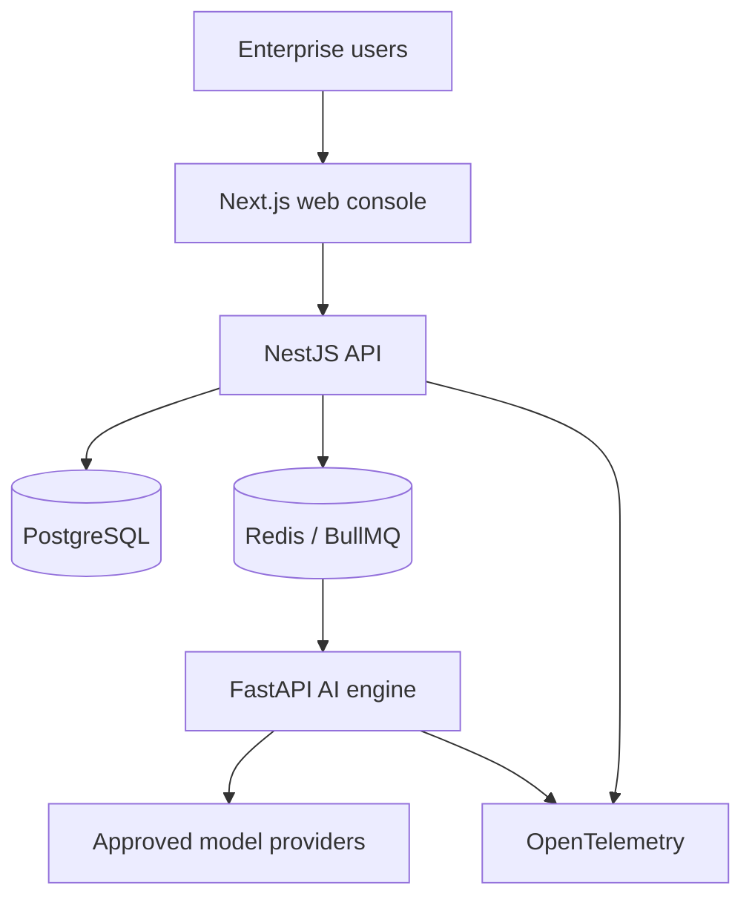

# SentinelAI Architecture

## Design goals

1. A single control plane for AI assets, governance workflows, risk, quality, security, and operations.
2. Strong tenant boundaries and server-side authorization.
3. Auditable decisions: every assessment and approval records its actor, inputs, outcome, and timestamp.
4. Asynchronous execution for expensive evaluations and monitoring tasks.
5. Provider-neutral interfaces so model vendors can be changed without rewriting governance workflows.

## Logical architecture

## Service boundaries

### Web application

Owns presentation, accessible navigation, form state, and API client integration. It must not be trusted to enforce permissions.

### API

Owns identity, organizations, memberships, roles, asset metadata, governance workflows, audit events, and authorization. All organization-scoped queries must include a verified organization context.

### AI engine

Owns provider adapters, evaluation orchestration, risk-scoring components, and security test execution. It receives narrowly scoped requests from the API and must not have unrestricted access to internal networks or arbitrary tools.

### Data and jobs

PostgreSQL is the source of truth. Redis is used for transient cache and job transport, not as the only store for audit or governance records.

## Initial module boundaries

- Identity and access
- Organizations and tenancy
- AI asset registry
- Risk and policy
- Evaluation and benchmarking
- Security testing
- Approvals and incidents
- Usage and cost
- Audit and reporting

## Key architectural decisions

- Begin with a modular monolith for the API and a separately deployable Python AI engine.
- Use explicit API versioning under `/api/v1`.
- Keep provider credentials server-side and out of browser bundles.
- Use background jobs for long-running evaluations; expose job state through API polling or server-sent events.
- Record immutable assessment snapshots so historical results remain interpretable after policy changes.
